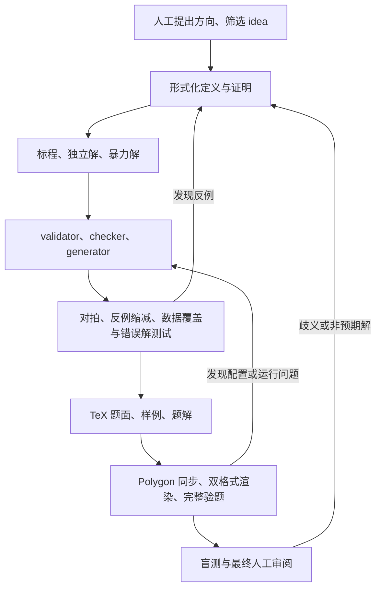

# 面向 ACM / Codeforces Polygon 的 AI 辅助出题工作流

调研日期：2026-10-26。主流程与独立验题 Skill 已在仓库落地；执行工具、题目模板与 MCP 封装仍为设计建议。

推荐采用 **Git 管理题目源文件 + 本地可重复执行的验证工具 + 阶段式 Skill + Polygon 官方 API**。先用一道完整题验证 rbx 能否承担执行工作，MCP 放在需要统一工具入口时加入。

这套工作流最有价值的能力，是让每个题目结论都有可追溯的依据：数学定义、正确性证明、独立实现、小规模对拍、针对错误解的数据，以及平台实际运行结果。

## 1. Skill、CLI、MCP 分别负责什么

| 层次 | 建议职责 | 产出 |
| --- | --- | --- |
| 题目仓库 | 保存定义、代码、TeX、数据生成方案和变更历史 | 可审查、可恢复的题目版本 |
| CLI / rbx | 编译、生成、校验、对拍、运行各类解、打包 | 退出状态、结构化报告、可复现反例 |
| Skill | 指导 AI 如何设计题目、写证明、实现程序、分析失败、检查题面 | 文件修改和针对报告的判断 |
| Polygon 接入 | 同步源文件和配置、渲染、运行平台验题、取回结果 | 平台上的题目与验题证据 |
| 可选 MCP | 将上述操作封装为参数明确的工具，供不同客户端调用 | 稳定的工具接口 |

Skill 很适合承载反复使用的流程、参考资料和模板；MCP 提供数据与操作入口。这与 OpenAI 官方对二者的划分一致。下面的具体分层是针对本项目的设计建议。[官方说明](https://developers.openai.com/plugins/concepts/skills)

**质量检查应落实在执行工具中。** 例如，“所有正式数据必须通过 validator”应由命令检查并返回失败状态；Skill 负责要求 AI 调用检查、解释结果和修复问题。



## 2. 按阶段组织流程

| 阶段 | AI 的主要工作 | 进入下一阶段的条件 |
| --- | --- | --- |
| Idea 与形式化 | 给出候选、核心性质、数学定义、预期解法、可能的更简单解法 | 人确认题意与出题目标；关键定义没有悬而未决的歧义 |
| 解法与原型 | 写证明、复杂度分析、标程和小规模暴力；检查其他复杂度的解法 | 证明经过审阅，小规模穷举或对拍没有未解决分歧 |
| 输入与判题 | 用 testlib 写 validator；选择标准 checker，必要时写自定义 checker | 输入正反例测试通过；判题规则与输出定义一致 |
| 数据设计 | 按性质设计 generator 和生成清单 | 每份数据可复现、通过 validator、具有明确测试目的 |
| 验题测试 | 运行正确解、错误解、慢解；寻找并缩减反例 | 正确解全通过；预期错误解被有针对性地检出；时限有实测依据 |
| 题面与题解 | 编写 TeX、样例解释、证明和代码对应说明 | 样例自动复算；题面、约束、validator、题解保持一致 |
| Polygon 集成 | 同步、渲染、打包验题、取回逐测试结果 | 渲染和完整验题通过，警告已检查 |
| 独立验题 | 仅根据题面解题，检查理解与实现 | 歧义、非预期解和难度判断已有处理结论 |

这些是阶段检查条件，正常的编译、对拍和修复可以连续执行。适合由人集中判断的节点是：选定题目定义、确认难度与时限、最终交付。

### 先把“数学合同”写清楚

建议每题先有一份 `spec.md`，明确：

- 输入对象、合法范围、多个测试用例的总量约束。
- 允许的操作，以及顺序、重复、相等值、空集等语义。
- 求解目标、解是否唯一、无解如何表示、输出满足什么条件。
- 正确性证明、目标复杂度、整数范围及中间运算的溢出分析。
- 预期错误思路、潜在更快或更简单的解法、需要专门验证的猜想。

`spec.md` 保存数学语义，TeX 保存面向选手的表述，执行配置保存编译与测试参数。约束常量可以共用或通过模板生成；关于“恰好”“至多”“可重复”等语义仍需交叉审阅。

## 3. 正确性与数据质量的核心闭环

### 标程需要独立依据

推荐保留以下角色：

| 程序 | 用途 | 验证范围 |
| --- | --- | --- |
| `main.cpp` | 生成标准答案、验证目标复杂度 | 全部正式数据 |
| `independent.cpp` | 用独立推导或不同实现检查标程 | 尽量覆盖全部正式数据 |
| `brute.cpp` | 通过枚举、搜索等直接定义求解 | 明确限制的小规模数据 |
| `wrong_*.cpp` | 模拟具体错误思路或实现缺陷 | 找到能稳定检出该缺陷的数据 |
| `slow_*.cpp` | 数学上正确，但复杂度过高 | 小数据核对正确性，大数据验证时限区分 |

只在小规模正确运行的暴力解应有明确范围，上传 Polygon 时也要据此配置，避免误标为全规模正确解。把同一份标程改写一遍，对独立验证的帮助有限。

唯一答案题可以按所选 checker 的语义比较输出；多解、构造题要验证输出的合法性和目标值。小规模时尽量使用独立的判定逻辑，降低标程和自定义 checker 共享同一错误的风险。

随机对拍提供反例搜索证据，小规模穷举提供有限范围内的完整检查；两者都要与证明结合使用。

### validator 要覆盖结构约束，也要接受正确输入

按用户要求，validator、generator 和自定义 checker 都使用 C++ testlib。对应入口为 `registerValidation(argc, argv)`、`registerGen(argc, argv, 1)` 和 `registerTestlibCmd(argc, argv)`。[testlib 维护者文档与示例](https://github.com/MikeMirzayanov/testlib)

validator 除了单个数值范围，还要检查总量限制、图的连通性、重边、自环、排列、字符串字符集等题意要求，并正确处理分隔符与 EOF。验证测试至少同时包括：

- 合法输入：最小值、最大值、结构边界、多个测试用例的合法极限。
- 非法输入：越界、漏项、额外内容、违反结构条件、总量超限。

仅检查“生成的数据都被接受”无法发现 validator 误收非法输入，也容易遗漏它误拒合法输入的问题。testlib 的严格读取和 `readEof()` 用法可参见[官方输入流文档](https://github.com/MikeMirzayanov/testlib/blob/master/_autodocs/api-reference/instream.md)。

### checker 本身也需要验题

先根据输出语义选择标准 checker：整数、词元、行结构、浮点数的比较方式可能不同。浮点容差要与题面一致；有多种合法输出时，标准文本比较通常不足以表达要求。[标准 checker 源码](https://github.com/MikeMirzayanov/testlib/tree/master/checkers)

自定义 checker 应测试：合法的不同答案、非法构造、错误最优值、伪造无解、缺失或多余输出、数值边界。特别检查它是否错误地依赖标程输出的具体形式，以及输入、选手输出、标准答案三个流是否使用正确。

### 数据按“要发现什么错误”设计

每组数据记录其目的，常见类别包括：边界、极端分布、重复值、退化结构、溢出、复杂度最坏情况、贪心反例，以及有限预算的随机数据。

例如图题不能只生成均匀随机图，还可能需要链、星形、多个连通块、接近约束上限的稠密结构；具体取舍来自该题性质。合法的结构必须与 `spec.md` 一致。

建议形成“错误解 × 数据”的结果矩阵：

| 错误解 | 缺陷 | 负责检出的数据 | 要观察的现象 |
| --- | --- | --- | --- |
| `wrong_greedy.cpp` | 局部最优推导错误 | 专门构造的反例 | 答案不正确 |
| `wrong_ties.cpp` | 相等值处理错误 | 大量相等或重复元素 | 答案不正确 |
| `wrong_int.cpp` | 中间运算使用窄整数 | 达到中间值极限的数据 | 答案不正确或运行错误，记录实际原因 |
| `slow_n2.cpp` | 二次复杂度 | 经测量的最坏情况数据 | 超时 |

预期错误解在部分测试上 AC 很正常；应检查整套测试能否检出其缺陷，并遵循 Polygon 对 solution tag 的判定规则。将意外 RE 当成成功检出贪心错误，会掩盖数据设计问题。

### 反例自动沉淀成回归数据

每次发现差异，保存输入、完整生成参数、源码与工具版本、双方输出、checker 结果。随后缩减反例；缩减过程必须保持输入合法，并保留原来的分歧。确认原因后，把反例加入固定回归集。

testlib 使用命令行参数初始化随机生成，因此复现记录应包括完整参数、生成器源码、testlib 版本和构建信息。仅保存一个名为 seed 的数值不够。建议固定依赖版本，并为生成的数据记录哈希。[testlib 随机生成源码](https://github.com/MikeMirzayanov/testlib/blob/master/testlib.h)

必要时加入变形测试，例如重标号后答案不变；使用前先证明这个性质对当前题目成立。

## 4. TeX 题面与 Polygon 的衔接

题面和题解分别维护 TeX 源文件。根据 Polygon 字段与模板组织 legend、input、output、notes 等内容，再由适配层上传；采用 rbx 时优先使用它的题面模板。

Polygon 的 HTML 渲染只支持受限的 TeX 命令集，因此 **PDF 与 HTML 都要检查**。本地通用 LaTeX 编译通过，只能说明本地编译器接受源文件。[Polygon TeX 手册](https://polygon.codeforces.com/docs/statements-tex-manual)

样例建议以同一组输入、输出文件为来源，自动核对输出并供题面引用。题面审阅要明确覆盖：量词、下标、闭区间、总量约束、无解格式、容差、样例解释，以及中英文版本的一致性。

Polygon 官方 API 当前已经能完成大部分常见同步与验题操作：

| 操作 | 相关官方 API |
| --- | --- |
| 题面、源文件、解、生成脚本与测试配置 | `problem.saveStatement`、`problem.saveFile`、`problem.saveSolution`、`problem.saveScript`、`problem.saveTest` 等 |
| 题面与题解的 HTML / PDF 渲染 | `problem.renderStatements` |
| validator / checker 测试的配置与已有结果读取 | `problem.validatorTests`、`problem.checkerTests` 及对应保存方法 |
| 平台对拍 | `problem.saveStress`、`problem.runStresses`、`problem.stresses` 等 |
| 构建并验题 | `problem.buildPackage`，设置 `verify=true` |
| 已存逐解、逐测试运行结果 | `problem.invocations`、`problem.invocation` |

能力以当前[官方 API 文档](https://codeforces.github.io/polygon-misc/API)为依据。具体行为与边界见本仓库的[Polygon / testlib 调研记录](research/polygon-testlib-research.md)。

平台适配必须区分“请求被接受”“任务结束”“验题通过”：顶层 API `OK` 不代表各项题面都渲染成功，启动构建也不代表包已经可用。最终要综合 package 状态和 comment、预期结果是否齐全、运行 verdict 与 tag 是否一致，以及 warnings；缺失或无法解析的结果应标记为未知。

本地源文件作为主要维护来源。同步前读取远端并生成差异清单，遇到 Polygon 上的人工修改时显式处理冲突；API 操作失败后先读回状态，再决定重试。将这个机制落实为工具，能避免反复上传时误覆盖或重复创建对象。

## 5. 现有工具优先评估 rbx

rbx 的官方资料列出了 testlib 集成、生成与校验、按预期 verdict 运行解、stress testing，以及 Polygon 打包和 API 上传能力。它与本项目的执行需求重合度很高。[项目介绍](https://rbx.rsalesc.dev/)、[对拍文档](https://rbx.rsalesc.dev/setters/stress-testing/)、[Polygon 打包与上传](https://rbx.rsalesc.dev/setters/packaging/polygon/)

建议先做一次兼容性验证：用一道普通整数答案题，走通 validator、generator、标程、暴力、WA、慢解、TeX 与 Polygon 上传验题。确认目录约定、配置映射和报告是否适合 AI 使用后，再决定封装范围。

**与你当前环境有关的限制：rbx 官方明确不支持原生 Windows。** 官方建议通过 WSL 使用，并将仓库克隆到 WSL 文件系统；直接使用 Windows Git 检出的目录再挂载进去，默认可能无法保留它需要的符号链接。当前项目在 `D:`，采用 rbx 前需要安排独立的 WSL 工作副本。[安装说明](https://rbx.rsalesc.dev/intro/installation/)

- 接受 WSL / Linux：优先评估 rbx，只补本项目缺少的报告、阶段检查与 AI 指令。
- 必须在原生 Windows 使用：可以用 Python CLI 调度 C++ / testlib、TeX 和 Polygon API；先实现单题闭环，再补高级功能。

Kattis problemtools 可以作为其他平台适配的参考，但它主要面向 Kattis problem package format。当前以 Polygon 为目标，建议优先验证上述路线。[problemtools 维护者说明](https://github.com/Kattis/problemtools)

本地性能测试用于寻找最坏情况和比较算法。时限与内存上限最后结合 Polygon 的目标编译器和实际运行结果确认，保留多次测量及合理余量；使用 sanitizer 的正确性检查与正式计时分别进行。

## 6. Skill 的最小组织方式

已提供 **一个主流程 Skill，加一个独立验题 Skill**。阶段细节放在引用文档中，按需要读取。

- [acm-authoring](../.agents/skills/acm-authoring/SKILL.md)：输入 `$acm-authoring`，指定题目目录与本次出题目标。
- [acm-independent-review](../.agents/skills/acm-independent-review/SKILL.md)：在干净上下文中输入 `$acm-independent-review`，提供选手可见材料。

```text
.agents/skills/
  acm-authoring/
    SKILL.md
    agents/openai.yaml
    references/
      design.md
      implementation-and-testing.md
      statement-and-editorial.md
      polygon.md
      polygon-api.md
  acm-independent-review/
    SKILL.md
    agents/openai.yaml
    references/
      review-report.md
```

这是当前 Skill 目录；`.agents/skills` 是 Codex 支持的仓库级 Skill 位置。Skill 可以包含引用、模板和脚本，并按需加载详细指令。[官方 Skill 文档](https://developers.openai.com/codex/skills/)

主 Skill 每次先读取题目文件和检查报告，确认当前缺口，再调用工具推进工作。它应要求 AI 保留证明依据、测试范围、错误解意图、未解决疑问和反例来源，避免仅凭对话中的“已完成”继续推进。

独立验题 Skill 在新的上下文中只读取题面与允许给验题者的材料，先形成解法与实现，再对照出题方材料。相同模型仍可能共享相似盲点；条件允许时引入真实选手盲测。

角色可以先顺序执行。后续需要并行时，再将题面审阅、独立解和数据攻击分开，并明确可读文件范围与文件写入归属。

## 7. 题目目录与报告

下面是概念目录；采用 rbx 时，以其实际配置和模板落地，执行参数尽量集中在 `problem.rbx.yml`，减少重复配置。

```text
problems/example/
  spec.md
  problem.rbx.yml
  statement/          # TeX 题面，按语言组织
  editorial/          # TeX 题解、证明与复杂度说明
  solutions/          # main、independent、brute、wrong、slow
  validator/
  checker/            # 自定义时使用；标准 checker 在配置中选择
  generators/
  tests/              # 样例、手工测试、固定回归反例
  testplan.md         # 数据目的、分布、对应错误解
  reports/            # 校验摘要、结果矩阵、性能与平台结果
```

生成的大数据、二进制和临时日志放在构建目录或制品存储中；Git 保存源码、生成清单、固定反例和必要的验题摘要。

报告至少记录：检查结论、失败项、适用范围、源码与数据哈希、工具链版本、生成参数、复现方式和日志路径。耗时运行由工具保存完整日志，向 AI 返回摘要和失败证据。

需要执行生成程序与待验解的工具，应设置时间、内存和输出上限，并正确终止超时任务。确定性结果适合缓存；时限判断仍需按目标环境重新测量。

变更后按影响范围重新检查：数学定义变化要重审整个链条；标程变化要重新生成答案并验题；checker 变化要重跑判题测试和解的结果矩阵；generator 变化要重新生成、校验和运行受影响的数据；题面文字变化要重新渲染，并检查是否改变了语义。

## 8. MCP 何时加入

如果 Codex 已能直接运行 CLI，第一版可以直接调用它。MCP 更适合后续需要跨客户端复用、统一远端凭据、管理长任务和提供稳定结构化结果时加入。

建议让 MCP 薄封装同一套执行工具。例如以下是自建接口示意，均非现成的 Polygon 官方方法：

| 工具 | 职责 |
| --- | --- |
| `problem_inspect` | 返回题目当前状态、缺失材料和已有检查的适用版本 |
| `problem_check` | 运行指定检查集，返回任务标识与报告位置 |
| `problem_stress` | 在预算内搜索反例，保存复现信息 |
| `polygon_diff` | 比较本地与远端，返回具体变更计划 |
| `polygon_sync` | 按变更计划同步并读回核对 |
| `polygon_verify` | 启动平台验题，并读取进度和最终结果 |

数学判断和题目质量审阅由 Skill 与人完成；工具负责执行、记录和检查明确的条件。远端认证留在适配层，AI 使用题目和任务标识即可。

## 9. 推荐实施顺序

1. **单题闭环。** 选一道普通非交互题，评估 rbx / WSL，走通本地校验、对拍、错误解测试、TeX 和 Polygon 完整验题。
2. **质量报告。** 补齐 validator 正反例、checker 测试、错误解结果矩阵、反例回归和版本绑定。确保失败时能明确定位原因。
3. **固化 Skill。** 将已实际跑通的流程整理成主 Skill、模板和独立验题 Skill，用不同题目验证指令是否可复用。
4. **可靠同步。** 补齐远端差异、冲突处理、状态读回、任务完成判定和结果完整性检查；再根据使用需求加入 MCP。
5. **扩展题型。** 依次覆盖多解构造、自定义 checker、浮点、子任务与交互题。交互题还需要 interactor、通信和死锁等专门验证。

第一阶段的完成标准是：从本地版本可以重建全部测试，正确解通过，预期错误解和慢解按预期被检出，反例可复现，TeX 双格式可用，Polygon 完整验题结果可追溯。

开发投入优先放在这条闭环上。题目积累之后，再用真实失败案例持续改进 Skill、生成策略和验题规则。
